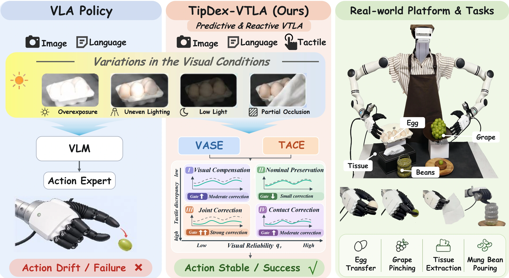

# TipDex-VTLA: Learning When to Refine Actions with Touch for Dexterous Manipulation

[**Project Page**](https://sez956.github.io/TipDex-VTLA/) · **Paper:** 正在加工 · [**Code**](https://github.com/tiplab/TipDex-VTLA) · **Checkpoints:** 正在加工

**TipDex-VTLA** is a vision, tactile, language, and action model for dexterous manipulation. It estimates when changes in lighting make visual guidance unreliable and verifies predicted contact against tactile measurements. The two signals guide corrections to actions the robot has yet to execute.

<p align="center">
  
</p>

## How it works

- **VASE** estimates how sensitive the planned actions are to lighting changes.
- **TACE** compares forecast touch with time-aligned measurements and uses the discrepancy together with visual reliability to refine upcoming actions.

## Evaluation

| Setting | Tasks | Mean full-task success |
| --- | ---: | ---: |
| Real world, standard lighting | 4 | 87.5% |
| Real world, unseen lighting | 4 | 73.8% |
| UniVTAC simulation, standard simulated lighting | 8 | 84.9% |

The [project page](https://sez956.github.io/TipDex-VTLA/) includes the full results, architecture, four real-world task recordings, ten lighting demonstrations, and eight simulation recordings.

## Repository layout

```text
docs/
  index.html          Project page
  content.js          Demo catalog and evaluation tables
  app.js, demos.js    Figures, tables, and video players
  style.css          Shared site styles
  research.css       Research page styles
  assets/            Figures and web versions of the demo videos
```

This repository currently contains the project website and demos. The training and inference implementation and model checkpoints are not part of this release.

## Preview the website

```sh
python -m http.server 8765 --directory docs
```

Open [localhost:8765](http://localhost:8765/) in a browser.
