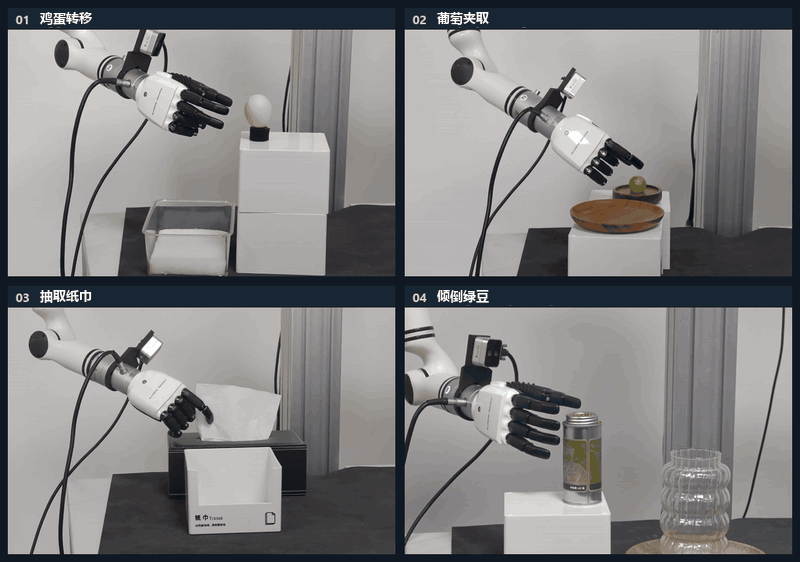
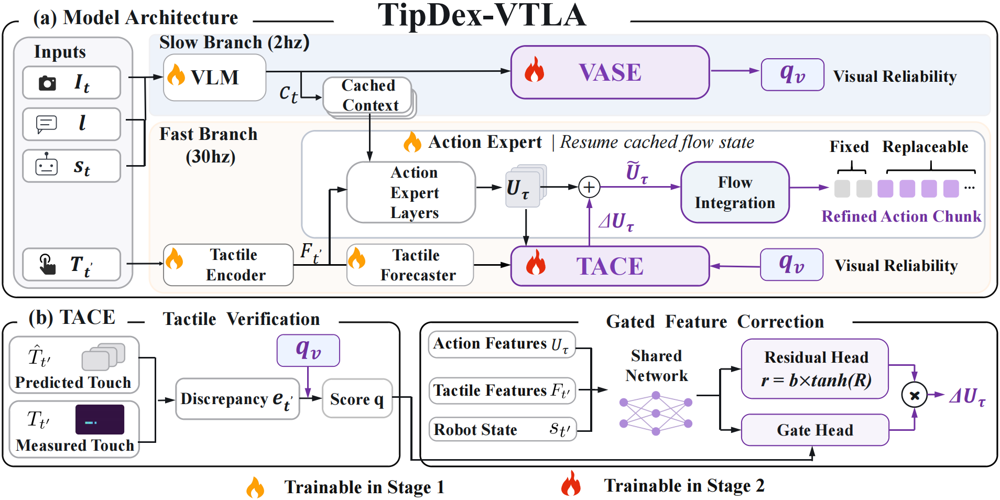

<div align="center">

# TipDex-VTLA

**Learning When to Refine Actions with Touch for Dexterous Manipulation**

Official inference implementation

[](https://tiplab.github.io/TipDex-VTLA/)
[](https://arxiv.org/abs/2611.25683)
[](https://huggingface.co/penguin3333333/TipDex-VTLA)
[](https://huggingface.co/datasets/penguin3333333/TipDex-Data)
[](LICENSE)
[](pyproject.toml)

**English** | [简体中文](README_zh-CN.md)

</div>

## Table of Contents

1. [Introduction](#1-introduction)
2. [Model Summary](#2-model-summary)
3. [Downloads](#3-downloads)
4. [How to Run Locally](#4-how-to-run-locally)
5. [License](#5-license)
6. [Citation](#6-citation)

## 1. Introduction

**TipDex-VTLA** is a vision–tactile–language–action framework for dexterous manipulation under changing illumination. It estimates visual reliability and checks tactile predictions against incoming measurements to regulate action refinement during execution.

This repository provides the official inference example, including model loading, slow–fast inference, **VASE**, **TACE**, and a live reliability dashboard. The **TipDex-VTLA** model package and the paired **TipDex-Data** demonstration dataset are available on Hugging Face.

<p align="center">
  
  <br>
  <em>Real-world dexterous manipulation. Full videos are available on the <a href="https://tiplab.github.io/TipDex-VTLA/">project page</a>.</em>
</p>

## 2. Model Summary

<p align="center">
  <a href="figures/architecture.png"></a>
</p>

- **Visual Action Sensitivity Estimation (VASE).** Predicts action-relevant visual reliability from the visual–language–state context, before tactile fusion.
- **Shared tactile encoding and forecasting.** The Action Expert and tactile forecaster share a tactile encoder. Forecasts are verified against measurements at matching times and only when intervening commands are consistent with the forecast.
- **Tactile Anticipation and Correction during Execution (TACE).** Combines visual reliability and verified tactile error to gate bounded corrections to Action Expert features.
- **Slow–fast execution.** Reuses cached context and intermediate flow states to update replaceable, unexecuted actions while preserving committed commands and execution times. Accepted action updates trigger new tactile forecasts.

| TipDex-VTLA component | Description |
| --- | --- |
| Policy | Egg-transfer backbone, checkpoint 9309 |
| Reliability | Independent VASE and TACE modules |
| Inputs | Three RGB views, a language instruction, 19-dimensional robot state, and F1 tactile history |
| Actions | 30-step chunks with 13 joint targets per step: 7 arm joints and 6 hand joints |
| Tactile forecast | 364 normalized values per frame, displayed as a 14 × 26 heatmap |
| Runtime | Local replay, HTTP inference, configuration page, and VASE / TACE / q dashboard |

The heatmap uses SDK register order: `heatmap[r, c] = raw364[26*r + c] / 65535`. Its cells represent register indices, not anatomical regions or calibrated force. Conversion, normalization, and encoder inputs are documented in [the method](docs/METHOD.md#触觉表示与转换).

## 3. Downloads

| Resource | Contents | Download |
| --- | --- | --- |
| **TipDex-VTLA** | Policy, VASE, TACE, shared-encoder tactile forecaster, tokenizer, normalization statistics, and an inference sample | [Hugging Face Model](https://huggingface.co/penguin3333333/TipDex-VTLA) |
| **TipDex-Data** | 50 original trajectories and 50 paired trajectories with RGB illumination perturbations | [Hugging Face Dataset](https://huggingface.co/datasets/penguin3333333/TipDex-Data) |

The model package includes an example observation for replay. Downloading the full dataset is optional for running that example. Model download and inference commands are provided in [Section 4](#4-how-to-run-locally); the dataset card describes its files and pairing metadata.

## 4. How to Run Locally

### 4.1 Installation

Use **Linux, Python 3.11, and an NVIDIA GPU with CUDA 12 support**. The release was validated on an NVIDIA A100 80 GB; exact package versions are listed in [requirements-tested.txt](requirements-tested.txt).

```bash
git clone https://github.com/tiplab/TipDex-VTLA.git
cd TipDex-VTLA
python3.11 -m venv .venv
source .venv/bin/activate
pip install ".[cuda]"
```

### 4.2 Download the model

```bash
export MODEL_DIR="$(python -c 'from huggingface_hub import snapshot_download; print(snapshot_download(repo_id="penguin3333333/TipDex-VTLA"))')"
tipdex verify --model "$MODEL_DIR"
```

The complete package includes tokenizer and normalization files. You can also set `MODEL_DIR` to an existing local model directory. Fixed-revision loading and the verified release reference are documented in [model releases](docs/MODEL_RELEASE.md).

### 4.3 Run the inference example

```bash
CUDA_VISIBLE_DEVICES=0 tipdex replay \
  --model "$MODEL_DIR" \
  --config paper \
  --output outputs/paper
```

This runs the actual model weights on the bundled observations and writes `report.json` and `prediction.npz`. Outputs include a `[30, 13]` action chunk, tactile forecasts displayed as `[H, 14, 26]`, visual reliability `q_v`, verified tactile error, and the final score `q`. Replay supplies simulated execution acknowledgements and does not send commands to a robot.

### 4.4 Start the inference service and dashboard

```bash
CUDA_VISIBLE_DEVICES=0 tipdex serve \
  --model "$MODEL_DIR" \
  --config paper \
  --port 8116
```

After model loading and warm-up, open:

- **Dashboard:** <http://127.0.0.1:8116/dashboard> — VASE, TACE, final `q`, verification status, and predicted tactile heatmaps.
- **Configuration:** <http://127.0.0.1:8116/config> — edit inference settings and export `inference.json`. Pass the exported file with `--config inference.json`.

In another terminal with the same environment and `MODEL_DIR`, send the bundled example through the HTTP interface:

```bash
python scripts/check_http.py \
  --example "$MODEL_DIR/example/observation.npz" \
  --url http://127.0.0.1:8116
```

This client also uses simulated execution feedback. For robot integration, connect the driver using the [deployment and execution-feedback protocol](docs/DEPLOYMENT.md). Stop the foreground service with `Ctrl+C`.

### 4.5 Documentation

| Documentation | Contents |
| --- | --- |
| [Deployment](docs/DEPLOYMENT.md) | Input schemas, timestamps, driver acknowledgements, action commits, and Python integration |
| [Method](docs/METHOD.md) | Paper definitions, implementation details, and configuration |
| [Inference validation](docs/VALIDATION.md) | Automated checks, real-weight replay, and HTTP validation |
| [Model releases](docs/MODEL_RELEASE.md) | Bundle structure, integrity checks, and fixed-revision loading |

VASE and TACE are separate modules under [`src/tipdex/VASE`](src/tipdex/VASE) and [`src/tipdex/TACE`](src/tipdex/TACE). Tactile forecasting and verification are under [`src/tipdex/forecast`](src/tipdex/forecast).

## 5. License

The source code is released under the [Apache License 2.0](LICENSE), with third-party components documented in [NOTICE.md](NOTICE.md). The model package includes Gemma/PaliGemma-derived parameters and the applicable [Gemma terms](https://huggingface.co/penguin3333333/TipDex-VTLA/blob/main/LICENSE_GEMMA.txt). Refer to the [model card](https://huggingface.co/penguin3333333/TipDex-VTLA) and [dataset card](https://huggingface.co/datasets/penguin3333333/TipDex-Data) for resource-specific information.

We acknowledge [Physical Intelligence / OpenPI](https://github.com/Physical-Intelligence/openpi) and the upstream libraries used by this implementation.

## 6. Citation

If you use TipDex-VTLA in your research, please cite:

```bibtex
@misc{tipdexvtla,
  title = {{TipDex-VTLA: Learning When to Refine Actions with Touch
            for Dexterous Manipulation}},
  author = {Ge, Xudi and
            Liu, Yepeng and
            Liu, Haifeng and
            Shi, Enze and
            Zhang, Liangqi and
            Xu, Yongchao},
  year = {2026},
  eprint = {2611.25683},
  archivePrefix = {arXiv},
  primaryClass = {cs.RO},
  url = {https://arxiv.org/abs/2611.25683}
}
```
