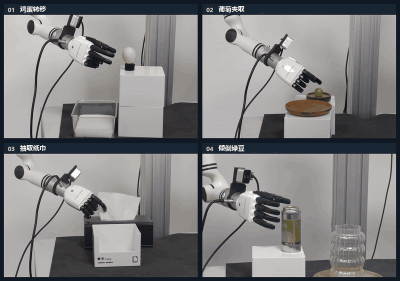
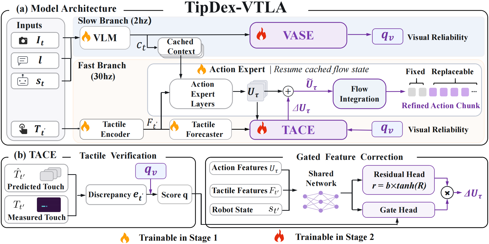

<div align="center">

# TipDex-VTLA

**Learning When to Refine Actions with Touch for Dexterous Manipulation**

官方推理示例

[项目主页](https://tiplab.github.io/TipDex-VTLA/) · [论文](https://arxiv.org/abs/2611.25683) · [模型](https://huggingface.co/penguin3333333/TiP-Dex-EGG) · [数据集](https://huggingface.co/datasets/penguin3333333/TipDex-VTLAdemo-data_EGG-TRANSFER) · [English](README.md)

</div>

## 目录

1. [简介](#1-简介)
2. [模型摘要](#2-模型摘要)
3. [下载](#3-下载)
4. [本地运行](#4-本地运行)
5. [许可](#5-许可)
6. [引用](#6-引用)

## 1. 简介

**TipDex-VTLA** 是面向光照变化下灵巧操作的视觉–触觉–语言–动作框架。它估计视觉可靠性，将触觉预测与实时测量进行核验，据此调节执行过程中的动作修正。

本仓库提供官方推理示例，包含模型加载、慢快推理、**VASE**、**TACE** 和实时可靠性面板。**TiP-Dex-EGG** 模型包及配对的 **EGG-TRANSFER** 示范数据集均已发布到 Hugging Face。

<p align="center">
  
  <br>
  <em>真机灵巧操作演示。完整视频见<a href="https://tiplab.github.io/TipDex-VTLA/">项目主页</a>。</em>
</p>

## 2. 模型摘要

<p align="center">
  <a href="figures/architecture.png"></a>
</p>

- **VASE：视觉动作敏感性估计。** 在触觉融合之前，从视觉、语言和状态上下文估计与动作相关的视觉可靠性。
- **共享触觉编码与预测。** Action Expert 和触觉预测器共享触觉编码器；预测与对应时刻的实测触觉核验，并检查期间命令与预测条件的一致性。
- **TACE：执行中的触觉预判与修正。** 融合视觉可靠性与经过核验的触觉误差，对 Action Expert 特征进行有界门控修正。
- **慢快执行。** 复用缓存上下文和中间流状态，更新可替换、未执行的动作，保留已提交命令和原始执行时间。接受动作更新后，重新生成触觉预测。

| TiP-Dex-EGG 组件 | 说明 |
| --- | --- |
| 策略 | 鸡蛋转移基座，检查点 9309 |
| 可靠性模块 | 独立的 VASE 与 TACE |
| 输入 | 三路 RGB、语言指令、19 维机器人状态及 F1 触觉历史 |
| 动作 | 30 步动作块，每步包含 7 个机械臂关节和 6 个手部关节目标 |
| 触觉预测 | 每帧 364 个归一化数值，显示为 14 × 26 热图 |
| 运行方式 | 本地回放、HTTP 推理、配置页及 VASE / TACE / q 面板 |

热图按 SDK 寄存器顺序转换：`heatmap[r, c] = raw364[26*r + c] / 65535`。像素位置表示寄存器序号，不表示解剖区域或已标定的力。完整转换、归一化和编码器输入见[方法说明](docs/METHOD.md#触觉表示与转换)。

## 3. 下载

| 资源 | 内容 | 下载 |
| --- | --- | --- |
| **TiP-Dex-EGG** | 策略、VASE、TACE、共享编码器触觉预测器、tokenizer、归一化统计与推理样例 | [Hugging Face 模型](https://huggingface.co/penguin3333333/TiP-Dex-EGG) |
| **TipDex-VTLAdemo-data_EGG-TRANSFER** | 50 条原始轨迹和 50 条配对 RGB 光照扰动轨迹 | [Hugging Face 数据集](https://huggingface.co/datasets/penguin3333333/TipDex-VTLAdemo-data_EGG-TRANSFER) |

模型包已包含回放观测样例，运行该示例无须下载完整数据集。模型下载与推理命令见[第 4 节](#4-本地运行)，数据文件与配对元数据说明见数据集页面。

## 4. 本地运行

### 4.1 安装

使用 **Linux、Python 3.11 和支持 CUDA 12 的 NVIDIA GPU**。发布版本在 NVIDIA A100 80 GB 上完成验证，具体依赖版本见 [requirements-tested.txt](requirements-tested.txt)。

```bash
git clone https://github.com/tiplab/TipDex-VTLA.git
cd TipDex-VTLA
python3.11 -m venv .venv
source .venv/bin/activate
pip install ".[cuda]"
```

### 4.2 下载模型

```bash
export MODEL_DIR="$(python -c 'from huggingface_hub import snapshot_download; print(snapshot_download(repo_id="penguin3333333/TiP-Dex-EGG"))')"
tipdex verify --model "$MODEL_DIR"
```

完整模型包包含 tokenizer 和归一化文件，也可将 `MODEL_DIR` 设置为已有的本地模型目录。固定版本加载方式及已验证的发布版本见[模型发布说明](docs/MODEL_RELEASE.md)。

### 4.3 运行推理示例

```bash
CUDA_VISIBLE_DEVICES=0 tipdex replay \
  --model "$MODEL_DIR" \
  --config paper \
  --output outputs/paper
```

使用真实模型权重处理包内观测，保存 `report.json` 和 `prediction.npz`。输出包含 `[30, 13]` 动作、可显示为 `[H, 14, 26]` 的触觉预测、视觉可靠性 `q_v`、经过核验的触觉误差及最终分数 `q`。回放提供模拟执行确认，不向机器人发送命令。

### 4.4 启动推理服务与面板

```bash
CUDA_VISIBLE_DEVICES=0 tipdex serve \
  --model "$MODEL_DIR" \
  --config paper \
  --port 8116
```

模型加载与预热完成后访问：

- **面板：** <http://127.0.0.1:8116/dashboard>，展示 VASE、TACE、最终 `q`、核验状态及触觉预测热图。
- **配置页：** <http://127.0.0.1:8116/config>，调整推理参数并导出 `inference.json`，启动时通过 `--config inference.json` 加载。

在另一个终端激活相同环境并设置相同的 `MODEL_DIR`，通过 HTTP 接口发送包内样例：

```bash
python scripts/check_http.py \
  --example "$MODEL_DIR/example/egg.npz" \
  --url http://127.0.0.1:8116
```

该客户端同样使用模拟执行反馈。真机接入请按照[部署与执行反馈协议](docs/DEPLOYMENT.md)对接设备驱动。按 `Ctrl+C` 停止前台模型服务。

### 4.5 文档

| 文档 | 内容 |
| --- | --- |
| [部署说明](docs/DEPLOYMENT.md) | 输入格式、时间戳、驱动确认、动作提交和 Python 接入 |
| [方法说明](docs/METHOD.md) | 论文定义、实现细节及配置 |
| [推理验收](docs/VALIDATION.md) | 自动检查、真实权重回放及 HTTP 验证 |
| [模型发布](docs/MODEL_RELEASE.md) | 模型包结构、完整性检查及固定版本加载 |

VASE、TACE 分别位于独立目录 [`src/tipdex/VASE`](src/tipdex/VASE) 和 [`src/tipdex/TACE`](src/tipdex/TACE)，触觉预测与核验位于 [`src/tipdex/forecast`](src/tipdex/forecast)。

## 5. 许可

源代码采用 [Apache-2.0](LICENSE) 许可，第三方组件说明见 [NOTICE.md](NOTICE.md)。模型包包含 Gemma/PaliGemma 派生参数，使用时适用随包发布的 [Gemma 条款](https://huggingface.co/penguin3333333/TiP-Dex-EGG/blob/main/LICENSE_GEMMA.txt)。具体资源信息见[模型卡](https://huggingface.co/penguin3333333/TiP-Dex-EGG)与[数据集卡](https://huggingface.co/datasets/penguin3333333/TipDex-VTLAdemo-data_EGG-TRANSFER)。

感谢 [Physical Intelligence / OpenPI](https://github.com/Physical-Intelligence/openpi) 及本项目使用的上游开源库。

## 6. 引用

如果本项目对你的研究有帮助，请引用：

```bibtex
@misc{tipdexvtla,
  title = {{TipDex-VTLA: Learning When to Refine Actions with Touch for Dexterous Manipulation}},
  author = {Ge, Xudi and Liu, Yepeng and Liu, Haifeng and Shi, Enze and Zhang, Liangqi and Xu, Yongchao},
  year = {2026},
  eprint = {2611.25683},
  archivePrefix = {arXiv},
  primaryClass = {cs.RO},
  url = {https://arxiv.org/abs/2611.25683}
}
```
